  

  

    
    
    
    
  

  

    
    
    
  

I'm an Information Technology Engineering student who loves turning ideas into working web apps. I like owning the whole stack: auth, sessions, real-time features and deployment. When I'm not building, I'm solving problems on Codeforces and LeetCode.

- 🔭 **Building:** [Converge](https://github.com/mishraaviral7002/Converge), a real-time collaborative whiteboard
- 🔐 **Recently worked on:** authentication, cookie-based sessions and room-based collaboration
- 🤖 **Next up:** an AI assistant for Converge
- 🧩 **Practicing:** data structures and competitive programming
- 🍵 **Fuel:** tea, always tea

  
  
  

  
   
  

  
  

  
  
    
  
    
  

 

  

